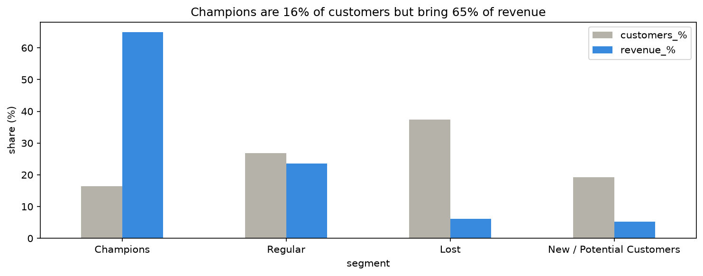

# UrbanKart Customer Segmentation (RFM + KMeans)

Group an online store's customers by buying behaviour, so each group can get a different marketing offer instead of one email for everyone.

> **Note:** This is a portfolio practice project built on a public dataset (UCI Online Retail). The client "UrbanKart / Priya" is a role-play scenario, not a real engagement.

## Problem

UrbanKart, an online gift and home décor store, sends the same email to all of its customers and sees little response. The goal is to split customers into a few clear segments (for example VIP customers and customers who are drifting away) and suggest one concrete marketing action per segment.

## Data

- **Source:** [Online Retail dataset on Kaggle](https://www.kaggle.com/datasets/tunguz/online-retail) (UK online gift store, Dec 2010 to Dec 2011). The data is **not included** in this repo.
- **Raw size:** 541,909 rows, one row per item bought.
- **After cleaning:** 392,692 rows and **4,338 customers**.

## Approach

1. **Cleaning.** Removed rows with no `CustomerID` (they cannot be assigned to a customer), cancelled orders and rows with zero or negative quantity, rows with zero or negative `UnitPrice`, and exact duplicates. About 27% of the raw rows were removed, mostly because of missing customer IDs.
2. **RFM features (one row per customer).**
   - **Recency:** days since the customer's last order, measured from a fixed snapshot date (one day after the last transaction in the data).
   - **Frequency:** number of distinct invoices.
   - **Monetary:** total spend.
3. **Log transform + scaling.** Spending is very skewed (median about 669, maximum 280,206), so a few huge customers would dominate KMeans. `log1p` followed by `StandardScaler` fixes this.

   | Feature | Skew before | Skew after |
   |---|---|---|
   | Recency | 1.25 | -0.38 |
   | Frequency | 12.07 | 1.21 |
   | Monetary | 19.34 | 0.40 |

4. **Choosing k.** Tried k = 2 to 8 and compared inertia (elbow) and silhouette score.

   | k | Inertia | Silhouette |
   |---|---|---|
   | 2 | 6483.6 | 0.433 |
   | 3 | 4869.5 | 0.337 |
   | 4 | 3939.0 | 0.338 |
   | 5 | 3296.7 | 0.316 |
   | 6 | 2855.8 | 0.312 |

   k = 2 has the best silhouette but is too coarse for marketing. k = 3 and k = 4 are tied (0.337 vs 0.338), so **k = 4** was chosen because four groups are easier to name and act on.

## Results

| Segment | Customers | Revenue | Median days since last order | Median orders | Median spend | Marketing action |
|---|---|---|---|---|---|---|
| Champions | 16.4% | **64.9%** | 8 | 10 | 3,723 | Early access to new collection, no discount (email) |
| Regular | 26.9% | 23.6% | 57 | 4 | 1,345 | Reminder + new products, small incentive after a 75+ day gap (email; WhatsApp only for opted-in customers) |
| New / Potential Customers | 19.3% | 5.2% | 17 | 2 | 480 | Free shipping on next order (email / SMS) |
| Lost | 37.4% | 6.2% | 175 | 1 | 296 | One-time limited win-back offer, then stop (automated email) |



**Key finding:** 16% of customers (Champions) bring about 65% of the revenue, while the Lost segment is 37% of customers but only 6% of revenue. Marketing effort should go to protecting Champions and Regular customers, not to expensive offers for Lost customers.

## Prediction app

A small Flask app takes Recency, Frequency and Monetary values and returns the customer's segment. It reuses the same log transform, scaler and KMeans model from training, and rejects invalid input (for example negative values).

## Project structure

```
urbankart-customer-segmentation/
├── data/                  # dataset goes here (not in repo)
├── model/                 # saved KMeans model, scaler and segment names
├── templates/
│   └── index.html
├── training.py
├── app.py
├── requirements.txt
├── segment_share.png
├── segment_summary.csv
└── README.md
```

## How to run

1. Download the dataset from the Kaggle link above and save it as `data/Online_Retail.csv`.
2. Install the libraries:
   ```
   pip install -r requirements.txt
   ```
3. Train the model (this also saves the files in `model/`):
   ```
   python training.py
   ```
   Close the chart window when it opens so the script can finish.
4. Start the app:
   ```
   python app.py
   ```
   Open http://127.0.0.1:5000 in your browser.

The saved model files only load reliably with the same scikit-learn version they were created with. If you see a version warning, run `training.py` again to rebuild them.

## Limitations

- **Soft segment boundaries.** The silhouette score is about 0.34, so segments overlap. Use them as marketing guides, not strict labels.
- **Returns.** Cancelled invoices were removed, but the original purchase of a returned item stays in the data, so spend may be slightly overstated.
- **Possible reseller.** One customer made 73 invoices worth about 280,000 in a year. This looks like a business or reseller account and may need separate handling. In a real project this would be a question for the client.
- **One year of data.** Revenue shares describe this period only, not lifetime customer value.
- **Cluster numbers can change on retraining.** Segment names are saved with the model, but after retraining the names should be re-checked against the segment profile table.
- **No measurement of the offers yet.** A real rollout should keep a holdout group that receives no offer, to check whether the offers actually increase purchases.
- The Flask app runs in debug mode and is meant for local use only.